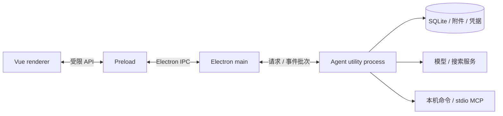

# 架构说明

## 1. 系统边界

Actl 是 Windows x64 桌面 Agent 应用。Electron 主进程管理桌面能力和运行时，Vue 展示业务，Agent utility process 承担模型循环、工具和数据访问。正常启动不监听业务 HTTP 端口。

| 层 | 入口 | 职责 |
| --- | --- | --- |
| 渲染进程 | [renderer/src/main.ts](../src/renderer/src/main.ts) | Vue、Pinia、导航、输入、输出、审批和设置 |
| Preload | [preload/index.ts](../src/preload/index.ts) | 通过 contextBridge 暴露受限业务和桌面 API |
| 主进程 | [main/index.ts](../src/main/index.ts) | 窗口、单实例、来源校验、目录和通知、Agent 生命周期 |
| Agent 进程 | [agent-worker.ts](../src/runtime/agent-worker.ts) | 请求调度、业务装配、事件批次和关闭确认 |
| Agent 核心 | [dependencies.ts](../src/agent-core/app/dependencies.ts) | 状态、模型、工具、权限、SQLite、附件、Skills、MCP、搜索 |



当前只提供 `local` 运行时，业务身份固定为 `developer:local`。没有云端运行时、多用户登录或外部业务 HTTP API。开发期间的 Vite 服务仅提供界面和 HMR；集成检查使用的 loopback 模拟模型服务属于测试设施。

## 2. 仓库布局

```text
src/main/                   Electron 窗口、IPC、桌面能力、进程管理
src/preload/                渲染进程受限桥接
src/renderer/src/           Vue 界面、Pinia、路由、业务客户端
src/shared/                 进程间消息契约与业务操作白名单
src/runtime/                utility process 入口与 AgentApplication
src/verification/           统一验证用例、报告类型与 MCP/命令 fixture
src/agent-core/app/         核心配置与依赖装配
src/agent-core/contracts/   schema、DTO、领域事件投影与错误映射
src/agent-core/runtime/     执行状态、循环、上下文、命令进程
src/agent-core/model/       模型能力及三种协议编解码
src/agent-core/tools/       工具注册与内置工具
src/agent-core/permissions/ 审批策略与命令分类
src/agent-core/repositories/ SQLite、schema、迁移与编解码
src/agent-core/stored-files/ 附件与图片快照
src/agent-core/security/    主密钥与凭据保护
src/agent-core/skills/      Skill 发现、解析和缓存
src/agent-core/mcp/         MCP 连接、配置、发现与调用
src/agent-core/web-search/  搜索配置、策略与供应商
scripts/                    启动、构建辅助和验证入口
docs/                       项目文档
```

验证直接使用 src/agent-core/ 中的产品实现，经单一 Agent 验证入口运行；不维护第二份业务实现或验证专用 utility process。

## 3. 启动与就绪

1. 主进程设置用户配置目录并取得单实例锁，创建带沙箱和 context isolation 的窗口。
2. 开发时加载 electron-vite 页面；生产时通过 `actl://app/index.html` 加载 renderer 产物，路由使用 hash。
3. Vue 经 `window.actlAgent.ready()` 请求 Agent 就绪。主进程读取桌面设置，复用已有 Agent 或启动 `agent-worker.cjs`。
4. 主进程创建匿名 Windows Job Object，将 utility process 加入后才允许业务初始化。分配失败则中止启动。
5. Worker 根据显式传入的 home 与模式创建日志、SQLite、凭据保护、模型、工具和 MCP，返回初始化结果。启动等待上限为 30 秒。
6. 前端加载项目、会话、模型和上次视图。前端自身的 ready 状态不代替 Agent 初始化确认。

应用使用 Electron 自带运行时，不单独寻找或启动用户机器上的 Node 来承载 Agent。外部命令和第三方 MCP 仍可能要求用户安装相应程序。

## 4. 依赖装配与业务入口

[dependencies.ts](../src/agent-core/app/dependencies.ts) 创建 WorkspaceStore、存储服务、SecretProtector、ModelStore、ProcessSupervisor、工具注册表、MCP 管理器、搜索服务、PromptCompiler 和 AgentLoop。

[AgentApplication](../src/runtime/agent-application.ts) 是业务用例入口：按操作校验参数、归属和引用，将执行委托给核心模块，再返回 DTO。它不创建窗口、不操作 Electron IPC，也不监听网络端口。依赖实例在一个 Agent 生命周期内复用。

## 5. 对话与事件

```mermaid
sequenceDiagram
  participant UI as Vue
  participant Main as Electron main
  participant App as AgentApplication
  participant Loop as AgentLoop
  participant Model as Model driver
  UI->>Main: stream(subscriptionId, command)
  Main->>App: request(id, command, stream=true)
  App->>Loop: 输入转换、引用校验、创建或继续 Run
  Loop-->>UI: response.created（经主进程批量转发）
  loop 模型与工具交互
    Loop->>Model: instructions + transcript + tools
    Model-->>Loop: ModelTurnEvent / Result
    Loop-->>UI: 文本、推理、工具参数和结果事件
  end
  App-->>Main: 最终完整 Response 或控制错误
  Main-->>UI: AgentResult
```

供应商协议、领域表示和界面 DTO 分离：驱动编解码原始网络协议；领域层使用 `TranscriptItem/AgentRunRecord/AgentDomainEvent`；界面使用 Response DTO 和 `response.* / agent.*` 事件。事件命名沿用响应协议，但桌面传输不是 SSE。

Worker 每 16 ms 或累计 64 个事件刷新一批，最终回复前刷新余下事件。主进程按请求关联转发。前端按序归并事件，并以本次请求返回的完整 Response 校准状态；旧历史查询和旧执行回复不能覆盖更新的审批或执行。消息契约见 [API](api.md)。

## 6. 关闭、重启与故障恢复

正常关闭先取消运行中的 Run，保留待审批任务；等待在途用例收尾，处置 Shell 和 MCP，清理附件、关闭数据库和日志，再发送 `stopped` 并退出。主进程同时要求关闭确认和正常退出，12 秒后仍未退出则终止直接进程，15 秒为最终关闭等待期限。

主进程持有 Agent Job 的唯一不可继承句柄。Agent 退出后，主进程终止 Job 中剩余进程，查询活动数直到归零，确认等待上限 5 秒。即使命令启动器已经退出，其普通后代仍属于 Job。主进程被强制终止时，Windows 关闭句柄并回收 Job 中的进程。

这管理的是 Agent 及普通 Shell/MCP 子进程链；通过系统服务、WMI 等在 Job 外创建的进程不在此生命周期约束内。

Agent 意外退出会使在途请求以 `runtime_interrupted` 失败，不自动重发请求。下一次就绪请求可重新启动 Agent。首次加载会话时，原 `in_progress` Run 恢复为 `failed/runtime_interrupted`，缺失的非待审批工具结果补为错误；`waiting_permission` 与批次保留，可继续审批。进程、未落库增量和事件流不会跨重启恢复。

## 7. 访问边界

渲染进程关闭 Node integration，启用 sandbox 与 context isolation；preload 不暴露通用 `ipcRenderer`、文件系统或任意执行入口。主进程检查发送窗口、主 frame、页面 URL 和命令白名单，Agent 再做 Zod、归属及权限校验。

生产资源协议限制主机、方法及 renderer 目录内路径；窗口阻止新窗口和外部导航，默认拒绝页面权限请求，Markdown 关闭原始 HTML。项目 cwd 是工具默认路径上下文，**不是操作系统沙箱**。业务审批不能代替 Windows 文件权限或进程权限。

实现见 [renderer-protocol.ts](../src/main/renderer-protocol.ts)、[desktop-agent.ts](../src/main/desktop-agent.ts) 和[桌面模块](modules/desktop.md)。
