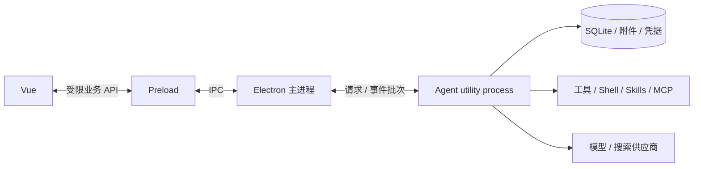

# Electron 迁移第二阶段

日期：2026-11-06。版本：0.2.2。运行基线保持 Electron 43.8.7 / Node 24.22.1。
旧 `Actl-tauri` 仓库未修改；新工程的安装、开发、构建和分发均独立完成。

## 已迁移范围

- Vue 聊天主界面、项目和会话导航、模型/供应商设置、权限面板、文件树、Skills、MCP 及其他设置界面。
- AgentLoop、三种模型协议适配、工具注册及执行、权限策略、会话和上下文、SQLite 仓库、附件、凭据、Skills、搜索和 MCP 核心。
- 长期存活的内部 Agent utility process；主进程负责启动就绪、请求关联、退出确认、重启及异常退出后的请求失败。
- 目录选择、存储位置设置、打开数据/日志/Skills/配置目录和系统通知改为 Electron 实现。
- 窗口重启使用相同存储布局；开发/发布数据和主密钥分离，保留旧 schema v18 与 `developer:local` 归属语义。

正常启动不监听业务 HTTP 端口，不启动 Express、独立 Node 服务或 Agent SEA exe，不依赖 Tauri/Rust。
开发时仅保留 Vite 的页面/HMR 服务。集成检查另起只监听 127.0.0.1 的模拟供应商，该测试服务不属于正常应用启动链路。

## 进程与通信

`src/shared/agent-ipc.ts` 定义允许的业务操作及消息契约。主进程检查来源窗口、主 frame 和页面 URL，
运行时按操作使用 Zod 校验数据并执行归属、工作区引用和权限检查。
旧前端的用例暂通过 `commandForRoute` 映射到具名操作；路径形状仅用于适配，不发 HTTP 请求。
保留原 DTO、事件投影和 reducer，降低消息时间线及审批界面的迁移改动。

流事件按请求关联并批量转发，完成回复前先发送剩余事件。卸载/刷新视图会解除事件订阅；
解除订阅不等于取消模型执行，显式取消使用独立操作。意外退出会令已有请求失败，不自动重发业务请求。
重新打开会话从持久化内容恢复；原进行中的 Run 恢复为 `failed/runtime_interrupted`。

## 本轮修正

- 附件服务改为接收文件元数据和字节，不再接收 Express Request 或 multipart；保留 25 MiB 单文件上限、哈希去重和会话归属校验。
- 正常退出仅取消正在执行的 Run，保留待审批记录。旧 `cancelAll()` 会连同待审批任务一起取消，不适合作为桌面重启处理。
- 关闭时等待请求收尾、子进程处置和数据库关闭，并按实际日志流的 `close` 事件确认日志已关闭。
- 移除前端端口设置、HTTP token、健康轮询和 Tauri 调用；旧数据 URL 字段暂保留为前端适配标识 `electron:ipc`，不含连接凭据。
- 使用 hash 路由，生产页面由受限 `actl://app` 协议提供；保留渲染沙箱与 context isolation，消息 Markdown 关闭原始 HTML。
- 相同用户数据目录使用单实例锁，避免多个桌面进程同时管理同一份 Agent 内存状态。
- Tiptap 及其扩展统一锁定到旧实现的 3.22.4；前端构建依赖不重复作为运行时 node_modules 分发。

## 验证结果

`pnpm typecheck` 与正式构建通过。以下八项在源码构建和真实打包环境均通过：

| 检查 | 验证内容 |
| --- | --- |
| 启动与配置 | 内部进程启动、项目/会话创建、合成凭据及模型目标保存 |
| 参数和附件 | 无效参数拒绝、中文附件字节往返、跨会话访问拒绝 |
| 流式对话 | 真实 AgentLoop 调用模拟模型、文本增量、严格递增事件序号、历史持久化 |
| 权限 | 批准后才写文件、拒绝不写文件、重复使用旧审批被拒绝 |
| 重启续跑 | 待审批记录、模型快照和加密配置跨重启保留，批准后继续执行 |
| 并发与取消 | 同项目并发冲突及明确错误码、运行中的响应可取消 |
| 故障恢复 | 终止 Agent 进程后在途请求失败，重启加载时恢复为中断状态 |
| 正常退出 | 清理完成后收到关闭确认，进程以 0 退出 |

第一阶段的六项基础能力及退出确认在最终打包环境中也回归通过。
桌面检查确认迁入的聊天主界面正常加载、Agent 就绪，并显示未配置模型时的引导。
未使用真实模型账户或读取旧项目凭据；所有模型请求都到本机模拟服务。

本轮证据：

- `artifacts/agent/source/2026-11-06T01-04-37-247Z/agent-report.json`
- `artifacts/agent/packaged/2026-11-06T01-04-38-888Z/agent-report.json`
- `artifacts/compatibility/packaged/2026-11-06T01-04-49-372Z/latest.json`
- `dist/Actl-0.2.0-windows-x64-setup.exe`

## 后续范围

旧用户数据的备份/导入流程尚未实现，不会自动打开或迁移旧目录。真实外部供应商、搜索服务和所有第三方 MCP 组合仍需专项验收。
Skills/MCP 等管理页面已接线并通过编译，尚未逐项做完整人工交互验收。
真实模型对话、工具调用、历史及待审批任务重启恢复已由用户验证；安装及其他功能的人工测试按用户反馈通过。
安装包尚未签名，使用默认图标；自动更新尚未实现。
Electron 45 的问题按用户要求暂缓，不在本阶段继续排查。

## 0.2.1 后台进程回收修复

复现：通过真实 Shell 工具启动一个 detached 后台进程，让启动器先退出，再结束 Agent。
旧实现按父 PID 调用 `taskkill /T`，父进程已消失时无法找到其后代；后台进程仍然存活。
修复前的失败记录：`artifacts/agent/source/2026-11-06T02-44-12-421Z/agent-report.json`。

主进程通过 Koffi 3.3.7 调用 Windows Job Object API，每个 Agent 独立创建匿名 Job，设置
`JOB_OBJECT_LIMIT_KILL_ON_JOB_CLOSE`，句柄仅由主进程持有且不可继承。
Agent 必须在加入 Job 后才能初始化业务，Shell/MCP 后代默认继承 Job；分配失败则中止启动。
正常关闭保留现有 Run、审批和数据库收尾，再终止剩余后代并查询活动进程数，确认归零后完成关闭。
Agent 异常退出触发相同清理；主应用被强制结束时，Windows 关闭 Job 句柄并回收其中进程。
参见 [Windows Job Objects](https://learn.microsoft.com/en-us/windows/win32/procthread/job-objects)。

集成回归新增启动器退出后的后台进程清理，并覆盖 Agent 异常退出和主进程强制终止。
主进程强制退出测试只终止主 PID，不使用 `taskkill /T`，以验证操作系统的实际回收能力。
测试使用隔离目录和本机模拟模型，不读取用户凭据或调用外部模型。
测试范围为普通 Shell/MCP 子进程链，不涵盖通过系统服务或 WMI 在 Job 外创建的进程。

源码与最终打包环境的 10 项 Agent 检查全部通过，打包环境的 6 项基础兼容性及退出确认也通过。
Koffi 的 Windows x64 原生模块已由打包器放入 `app.asar.unpacked`，实际加载及进程清理均已验证。

- 源码：`artifacts/agent/source/2026-11-06T02-46-48-896Z/agent-report.json`
- 打包：`artifacts/agent/packaged/2026-11-06T02-48-50-024Z/agent-report.json`
- 基础兼容：`artifacts/compatibility/packaged/2026-11-06T02-48-49-540Z/latest.json`
- 安装包：`dist/Actl-0.2.1-windows-x64-setup.exe`

## 0.2.2 实时审批界面状态修复

用户确认重启时后台进程均已自动关闭，但出现系统审批通知已弹出、应用内仍显示工具运行中，重启后才能看到审批的情况。
前端回归复现了：审批实时事件已写入状态并触发通知，随后迟到的历史查询结果清除了这条新审批。
另外，原审批续跑只处理推送事件，忽略了 IPC 请求最终返回的完整 Response；尾部事件未观察到时缺少状态校准。

- 为会话维护状态版本。历史回读期间收到实时事件、发起新执行或取消后，丢弃该旧查询的结果和错误状态。
- 对话和审批续跑结束后应用完整 Response 快照，恢复下一批审批或正确完成状态；审批快照补齐时沿用通知去重。
- 只有仍持有当前执行权的请求能应用完成快照，避免前一轮迟到回复覆盖下一轮审批。
- `pnpm test:agent-ui` 覆盖上述四个状态场景；修复前有三项失败，修复后四项通过。测试使用真实前端 Pinia 状态与公开用例，模拟 IPC 的时间顺序，不调用真实模型。

这不改变 Shell 的 `yieldTimeMs` 语义；等待审批时命令尚未执行，Shell 等待计时也尚未开始。
前端状态回归记录：`artifacts/permission-ui-regression.log`。
类型检查和 Windows 正式构建通过；0.2.2 打包应用的 10 项 Agent 检查全部通过，包含待审批跨重启恢复及后台进程回收。
打包回归记录：`artifacts/agent/packaged/2026-11-06T03-10-26-682Z/agent-report.json`。
安装包：`dist/Actl-0.2.2-windows-x64-setup.exe`。
