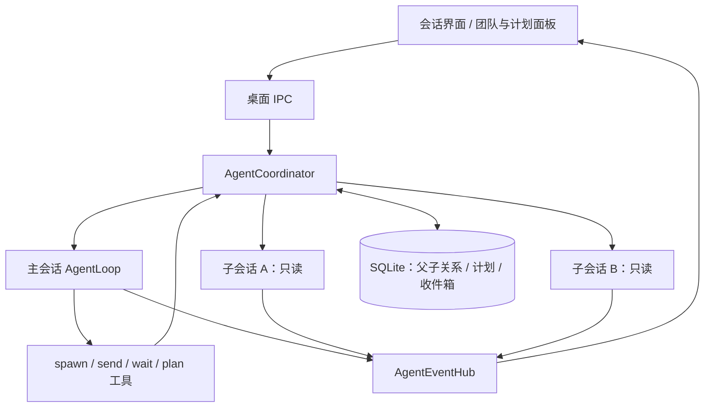

# 多 Agent 协作

当前实现是共享工作目录的父子协作：主 Agent 可分派多个只读子 Agent，自己负责文件修改和最终整合。子 Agent 有独立会话历史、Run、模型请求和取消信号，复用同一个 Electron utility process，不为每个 Agent 创建操作系统进程。

## 任务、会话与计划

- `Session` 保存 parentSessionId、rootSessionId，以及创建来源 originRunId/originCallId；重复执行同一 spawn 工具调用返回同一个子会话。
- 一个子任务对应一个子会话，首次任务说明放在输入消息中，后续追问继续该会话。当前没有独立的 Task 表或任务依赖图。
- `Run` 是一次实际执行，承载 in_progress、waiting_permission、completed 等状态。不能把 AgentLoop Promise 返回等同于任务完成，因为审批会暂停 Run。
- 根会话的 `AgentPlan` 独立持久化，包含 revision 和 `{id,text,status}` 条目。每次编译提示词都加入最新计划；主 Agent 显式维护状态，不根据子 Run 终态自动勾选。

子 Agent 使用新上下文，只收到分派说明、会话身份、计划及通常的项目提示；不会复制主 Agent 的完整历史。首次执行继承发起 Run 的模型目标和 reasoningEffort，强制 plan 权限模式。

## 工具与调度

| 工具 | 行为 |
| --- | --- |
| spawn_agent | 根 Agent 创建子会话，启动后立即返回 sessionId/runId，允许后台并行 |
| send_message | 同树直接父子之间发送持久化消息；空闲接收方可启动下一 Run |
| wait_agents | 根 Agent 等待直接子会话；任一停止运行、进入审批或到达 timeoutMs 时返回，最长 60 秒，可取消 |
| list_agents | 返回树成员、状态、最近输出摘要和计划 |
| interrupt_agent | 父 Agent 停止指定子会话及其后代 |
| update_plan | 根 Agent 使用当前 revision 更新整个计划，拒绝过期 revision |

协调器自动调度最多 3 个活动子 Agent，每个根会话最多 12 个子会话，达到总数后应追问已有子会话。当前禁止嵌套分派与兄弟会话直连；子 Agent 通过父会话汇总协作。

项目并发控制允许同树多会话同时运行，仍拒绝同项目其他根会话和同会话的第二个活动 Run。根 Run 先完成时，子 Run 仍持有该树的项目执行资格。

## 消息、完成与恢复

收件箱以 SQLite 为准。普通消息按来源 Run 和工具 call ID 去重，完成回执按子 Run ID 去重。AgentLoop 在工具结果补齐后的模型步骤边界消费消息，先写带来源标记的时间线，再确认收件箱；崩溃后通过消息 ID 检查避免重复写入。

接收方正在运行时，下一个步骤消费消息；空闲时，协调器发起新 Run；waiting_permission 时保留消息，必须解决原审批才能继续。子 Run 终态发送完成回执，主 Agent 收到后可以继续整合。自动启动失败时消息仍保留，可由后续显式执行消费。

停止根会话会取消整棵树，停止子会话只影响该子树，同时停止对应 ProcessSupervisor 会话进程，并抑制已排队消息的自动唤醒。明确的新用户输入或追问可以重新开始执行。退出时取消运行、等待协调器后台任务收尾；重启恢复关系、计划和回执，不自动调用模型。

## 只读边界与工作目录

子 Agent 只获得文件读取、目录/内容搜索、图片/附件读取、Skill 读取、网页查询和父子通信等允许工具。工具清单过滤与实际执行检查同时生效，模型自行输出 write_file、shell、MCP 或嵌套 spawn 调用也不会执行。

项目父子使用同一项目目录；独立会话父子使用根会话工作目录。此版本不需要 Git，不创建 worktree，也不合并分支。只读约束防止子 Agent 写入，但并不提供文件快照，主 Agent 修改文件期间子 Agent 可能读到变化。

## 界面与事件

团队面板显示子会话状态和计划，可进入子会话、追问、停止单个成员、停止整树及返回主会话。侧栏显示根会话，子会话从团队面板进入。

树订阅独立于创建 Run 的请求：初始快照加持续事件，detach 只解除显示订阅，后台任务继续。AgentEventHub 对同一领域事件只投影一次序号，前端同时收到旧请求流和树事件时去重。重新进入会话通过最新 response 快照及序号恢复。

主要实现：[协调器](../../src/agent-core/runtime/multi-agents/agent-coordinator.ts)、[协调持久化](../../src/agent-core/repositories/sqlite/agent-coordination-repository.ts)、[工具](../../src/agent-core/tools/builtin/subagent.ts)、[界面](../../src/renderer/src/agent/components/conversation/AgentTeamPanel.vue)。
