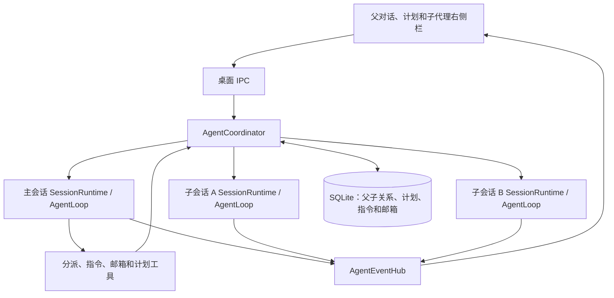

# 多 Agent 协作

主 Agent 和只读子 Agent 共享工作目录。主 Agent 负责文件修改和最终整合。每个会话有独立的 `SessionRuntime`、`AgentLoop` 和会话历史，每个 Run 有自己的模型请求和取消信号。通用会话能力位于 `runtime/session/`，跨会话准入由 `ExecutionAdmission` 统一管理。所有会话运行时都由同一个 Electron utility process 内的 `AgentCoordinator` 管理。

## 任务、会话与计划

- `Session` 保存 parentSessionId、rootSessionId，以及创建来源 originRunId/originCallId；重复执行同一 spawn 工具调用返回同一个子会话。
- 一个子任务对应一个子会话，首次任务说明放在输入消息中，后续追问继续该会话。当前没有独立的 Task 表或任务依赖图。
- `Run` 是一次实际执行，承载 in_progress、waiting_permission、completed 等状态。普通发消息、分派和下行指令共用协调器的启动路径。执行 Promise 返回 waiting_permission 表示原 Run 等待审批。
- 根会话的 `AgentPlan` 独立持久化，包含 revision 和 `{id,text,status}` 条目。每次编译提示词都加入最新计划；主 Agent 显式维护状态，不根据子 Run 终态自动勾选。

子 Agent 使用新上下文，只收到分派说明、会话身份、计划及通常的项目提示；不会复制主 Agent 的完整历史。首次执行继承发起 Run 的模型目标和 reasoningEffort，强制 plan 权限模式。

## 工具与调度

| 工具 | 行为 |
| --- | --- |
| spawn_agent | 根 Agent 创建子会话，启动后返回子会话的 sessionId 和状态，允许后台并行 |
| send_message | 根 Agent 向直属子会话发送持久化指令，空闲子会话以实际指令启动下一 Run |
| send_mail | 子 Agent 向直属父会话发送主题和正文 |
| list_mail / read_mail | 根 Agent 列出邮箱内的邮件摘要，或按邮件 ID 读取正文并标记已读 |
| wait_agents | 指定 1–12 个直属子代理，等待任一或全部运行结束（空闲也满足），或等待每个匹配子代理的未读邮件（默认结果邮件）。最长 60 秒，可取消，超时返回已有结果及仍未满足条件的子代理 ID |
| list_agents | 返回直属子代理的 sessionId、标题、状态及当前计划 |
| interrupt_agent | 父 Agent 停止指定子会话及其后代 |
| update_plan | 根 Agent 使用当前 revision 更新整个计划，拒绝过期 revision |

协调器自动调度最多 3 个活动子 Agent，每个根会话最多 12 个子会话，达到总数后应追问已有子会话。当前禁止嵌套分派与兄弟会话直连；子 Agent 通过父会话汇总协作。

项目并发控制允许同树多会话同时运行，仍拒绝同项目其他根会话和同会话的第二个活动 Run。根 Run 先完成时，子 Run 仍持有该树的项目执行资格。

## 消息、完成与恢复

指令队列和邮箱分别存储在 SQLite。指令和主动邮件按来源 Run 和工具调用 ID 去重，完成回执按子 Run ID 去重。指令在写入子会话后确认投递，重启后通过消息 ID 检查避免重复写入。

子代理运行时，指令会在下次模型调用前作为带来源的 `user` 消息加入时间线。子代理空闲时，协调器用实际指令发起新 Run。等待审批或自动启动失败时，指令留在队列。

子 Run 进入终态后，运行时自动发出回执邮件。来信只通知正在等待邮件的工具，父代理在当前或下一轮执行中按需读取。正文进入内部工具结果，桌面只收到邮件元数据。

停止根会话会取消整棵树，停止子会话只影响该子树。协调器会取消正在准备和执行的 Run，停止对应会话的后台进程，并抑制已排队消息的自动唤醒。明确的新用户输入或追问可以重新开始执行。退出时取消执行中的工作，保留待审批批次。重启恢复关系、计划和回执，等待显式输入再调用模型。

## 只读边界与工作目录

子 Agent 只获得文件读取、目录/内容搜索、图片/附件读取、Skill 读取、网页查询和父子通信等允许工具。会话工具入口统一过滤清单、校验调用和构造 ToolCallContext，审批后执行也经过这个入口。Shell 进程按 Session 归属，可以由同一会话后续的 Run 轮询。

项目父子使用同一项目目录；独立会话父子使用根会话工作目录。此版本不需要 Git，不创建 worktree，也不合并分支。只读约束防止子 Agent 写入，但并不提供文件快照，主 Agent 修改文件期间子 Agent 可能读到变化。

## 界面与事件

右侧栏「子代理」在列表上方显示计划。列表按父对话列出子会话和实时状态，可停止单个成员或整棵树。点击子会话会在右栏打开独立的只读对话标签。已打开的子会话会切回原标签，主区继续显示父对话。

树订阅独立于创建 Run 的请求，包含初始快照和持续事件。detach 只解除显示订阅，后台任务继续。协调器将领域事件投影一次，并将同一组带序号的事件发到请求流和树订阅。前端按序号去重，重新进入会话时通过最新 response 快照恢复。

主要实现见[协调器](../../src/agent-core/runtime/multi-agents/agent-coordinator.ts)、[协调持久化](../../src/agent-core/repositories/sqlite/agent-coordination-repository.ts)、[工具](../../src/agent-core/tools/builtin/agent-team.ts)和[子代理右侧栏](../../src/renderer/src/agent/components/sub-agents/AgentSidebarSubagents.vue)。
