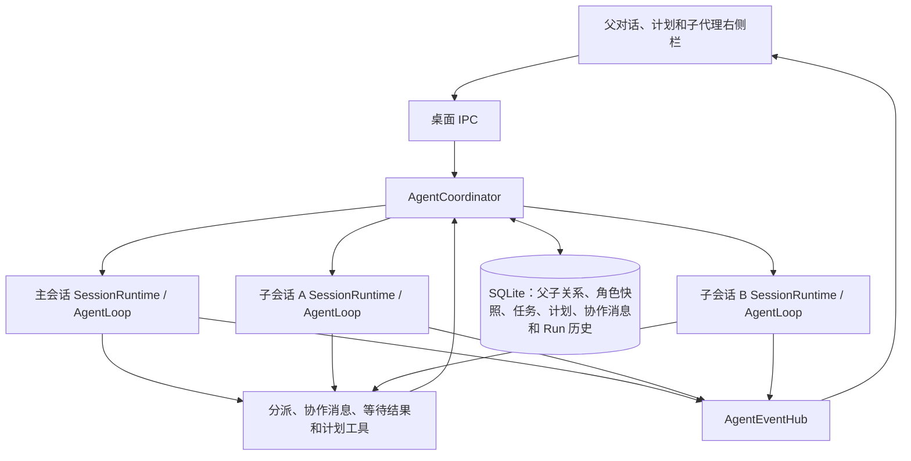

# 多 Agent 协作

主 Agent 和只读子 Agent 共享工作目录。主 Agent 负责文件修改和最终整合。每个会话有独立的 `SessionRuntime`、`AgentLoop` 和会话历史，每个 Run 有自己的模型请求和取消信号。通用会话能力位于 `runtime/session/`，跨会话准入由 `ExecutionAdmission` 统一管理。所有会话运行时都由同一个 Electron utility process 内的 `AgentCoordinator` 管理。



## 角色、会话和任务

- `profileId` 选择行为配置。`sessionId` 标识一个具体代理及其对话，并与父会话和根会话关联。子会话在创建时保存角色快照，后续任务和追问沿用该角色。新建子会话使用独立上下文。
- `Task` 是根会话内的工作记录，包含任务说明、验收标准、依赖、负责人、状态和 `revision`。每次认领或委派有独立的 `assignmentId`。可复用空闲子会话处理后续任务。
- `Run` 保存一次执行及输出。`wait_agents` 能按 Run 或消息 ID 读取执行结果。主 Agent 用 `complete_task` 验收同一归属下的结果并解锁依赖。
- `AgentPlan` 仍是主 Agent 维护的整体计划。它有独立 revision，条目由主 Agent 显式更新。

### 角色配置

内置角色为 `general`、`explore` 和 `review`。用户可以在 Actl 的数据目录下创建 `agents/<id>.md`。文件名提供角色 ID，YAML frontmatter 的 `name` 和 `description` 必填，正文为角色指令。以下文件可放在 `agents/review.md`：

```markdown
---
name: 代码审查
description: 查找正确性、兼容性和测试覆盖问题
---

按影响排序报告。给出文件位置、触发条件和证据。
```

frontmatter 可选 `modelTargetId` 和 `reasoningEffort`。模型 ID 指向 Actl 已配置的模型目标。省略时继承当前分派的模型，或续跑该子会话最近一次使用的模型。角色只能提供工作指令和模型偏好，子代理继续使用 `plan` 模式和只读工具。用户文件可覆盖同 ID 的内置角色，修改应用于新建子会话。角色 ID 以小写字母开头，可含小写字母、数字和连字符。无效文件不会出现在角色目录，显式选择时会报告错误。

## 工具与调度

| 工具 | 行为 |
| --- | --- |
| list_agent_profiles | 根 Agent 读取可委派的角色 ID、名称和用途 |
| create_task | 根 Agent 创建任务，提供 `title`、`instructions`、`acceptanceCriteria` 及可选 `blockedBy` |
| list_tasks | 父子 Agent 查看任务、当前归属、revision 和结果引用 |
| delegate_task | 根 Agent 提供 `taskId`、`expectedRevision` 和 `target`。指定 `{profileId}` 创建子会话，或指定 `{sessionId}` 分派给空闲子会话。返回任务、归属和消息 ID，Run 已启动时返回 `runId` |
| claim_task | 父子 Agent 提供 `taskId` 和 `expectedRevision`，为自己原子认领就绪任务并在当前 Run 中工作 |
| release_task | 根 Agent 或当前负责人释放任务，撤销该归属下尚未投递的下行消息。根 Agent 先等待或停止仍在执行的子 Agent |
| complete_task | 根 Agent 提供 `taskId`、`expectedRevision` 和 `runId` 验收结果，完成任务并解锁依赖 |
| send_message | 向直属父或子会话发送持久化消息。参数为 `sessionId`、`message`，可选 `purpose`（默认 `message`，也可用 `progress` 或 `clarification`）和引用原消息 ID 的 `replyTo`。返回 `sessionId`、`messageId` 和 `accepted` |
| wait_agents | 根 Agent 用 `targets` 指定 1–12 个不同的直属子代理，每项为 `{sessionId, runId}` 或 `{sessionId, messageId}`。`until` 为 `any`（默认）或 `all`。返回 `statuses`、`pendingSessionIds`、`needsInput` 和 `timedOut` |
| wait_for_message | 父子 Agent 都能用 `sessionId` 等待该直属对方发来的待投递消息，或通过 `replyTo` 等待某条已发送消息的回复。返回 `messageId`（匹配时）和 `timedOut` |
| list_agents | 返回直属子代理的 `sessionId`、标题、角色、状态、最新 Run 的 `runId`（如有）和当前计划 |
| interrupt_agent | 父 Agent 停止指定子会话及其后代 |
| update_plan | 根 Agent 使用当前 revision 更新整个计划，拒绝过期 revision |

简单工作由主 Agent 直接处理。需要子代理时先建任务再委派。依赖只能在创建时引用本树已有任务。所有依赖被验收后，任务才能被委派或认领。每个成员同时拥有一个任务，竞争时只有一个匹配 revision 的更新成功。委派事务同时写入任务归属和派单消息，工具重试复用原消息。启动报错时保留归属，根 Agent 可以追问重试，也可以释放后重新委派。Run 失败或停止后任务仍保持归属，直到根 Agent 或负责人释放。根 Agent 可在自己完成并验证工作后用当前 Run 验收自领任务。

协调器最多允许 3 个活动子 Agent，每个根会话最多 12 个子会话，达到总数后可将任务委派给已有的空闲子会话。当前禁止嵌套分派和兄弟会话直连，子 Agent 通过父会话汇总协作。

项目并发控制允许同树多会话同时运行，仍拒绝同项目其他根会话和同会话的第二个活动 Run。根 Run 先完成时，子 Run 仍持有该树的项目执行资格。

## 消息、完成与恢复

父子双方使用同一 SQLite 收件队列。运行时根据调用方写入真实发送者和来源 Run，并校验直属父子关系。`replyTo` 引用同一对代理之间从收件方发来的消息。重复执行同一个来源 Run 的工具调用会复用消息 ID。`accepted` 表示协调器已接受消息，收件方会话保存消息后才确认投递，重启后也按消息 ID 避免重复写入。

收件方运行时，排队消息在下一次可执行的模型调用前按序加入时间线。空闲子代理可以由下行消息启动新 Run，空闲父代理在下一轮处理已排队的上行消息。等待审批或自动启动失败时，消息留在队列。协作消息使用模型协议的 `user` 角色，模型输入带有运行时生成的发送方归属、消息 ID 和用途。`purpose` 用于说明消息意图，调度依据收件方的身份和运行状态。

父代理用 `wait_agents` 按 `runId` 读取指定执行的结果，或按 `send_message` 返回的 `messageId` 等待实际接收该消息的 Run。运行中的子代理可以在同一 Run 接收追问，空闲子代理可以由追问启动新 Run。消息尚未投递时，状态为 `queued`。状态项含 `sessionId` 和 `status`，并按已知信息附 `runId` 或 `messageId`。完成的 Run 可以附上最多 16000 字符的最终回复 `output`，失败的 Run 可以附上错误文本 `error`。超时也会返回已有结果。

等待目标 Run 中出现未回复的澄清时，`wait_agents` 提前返回，`needsInput` 列出 `{sessionId, runId, messageId}`。按消息等待时，若子代理当前 Run 的澄清阻碍这条追问投递，也会提前返回。澄清正文在下一模型步进入时间线，父代理可用 `send_message` 并把原消息 ID 填入 `replyTo`。子代理在同一个 Run 内用 `wait_for_message` 等待回复。指定 `replyTo` 时，已投递到当前会话历史的匹配回复也可以满足等待，工具结果只返回关联元数据。待投递消息仍走正常的时间线投递。

两个等待工具一次模型步骤只能单独调用，默认 `timeoutMs` 为 30 秒，最长 1 小时，可取消。等待期间当前 Run 和执行名额保持占用。

停止根会话会取消整棵树，停止子会话只影响该子树。协调器会取消正在准备和执行的 Run，停止对应会话的后台进程，并抑制已排队消息的自动唤醒。明确的新用户输入或追问可以重新开始执行。退出时取消执行中的工作，保留待审批批次。重启后仍可读取会话关系、计划、排队消息和 Run 结果，等待显式输入再调用模型。

## 只读边界与工作目录

子 Agent 只获得文件读取、目录/内容搜索、图片/附件读取、Skill 读取、网页查询和父子通信等允许工具。会话工具入口统一过滤清单、校验调用和构造 ToolCallContext，审批后执行也经过这个入口。Shell 进程按 Session 归属，可以由同一会话后续的 Run 轮询。

项目父子使用同一项目目录；独立会话父子使用根会话工作目录。此版本不需要 Git，不创建 worktree，也不合并分支。只读约束防止子 Agent 写入，但并不提供文件快照，主 Agent 修改文件期间子 Agent 可能读到变化。

## 界面与事件

右侧栏「子代理」显示计划和任务看板。任务可以展开查看说明、验收标准和依赖。子会话列表显示角色和实时状态，可停止单个成员或整棵树。点击子会话会在右栏打开独立的只读对话标签，主区继续显示父对话。

树订阅独立于创建 Run 的请求，包含初始快照和持续事件。detach 只解除显示订阅，后台任务继续。协调器将领域事件投影一次，并将同一组带序号的事件发到请求流和树订阅。前端按序号去重，重新进入会话时通过最新 response 快照恢复。消息界面按来源标记真人、父代理和子代理，模型协议的 `role` 仍用于模型上下文。

主要实现见[协调器](../../src/agent-core/runtime/multi-agents/agent-coordinator.ts)、[协调持久化](../../src/agent-core/repositories/sqlite/agent-coordination-repository.ts)、[工具](../../src/agent-core/tools/builtin/agent-team.ts)和[子代理右侧栏](../../src/renderer/src/agent/components/sub-agents/AgentSidebarSubagents.vue)。
